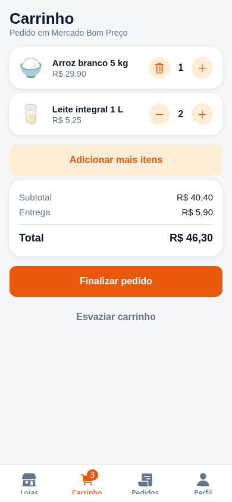
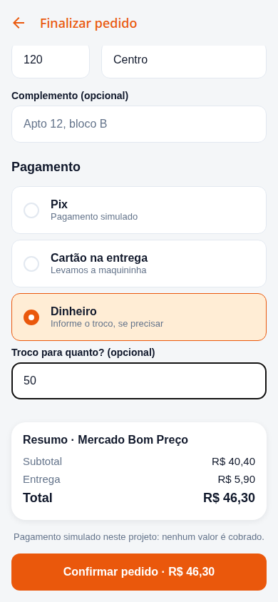
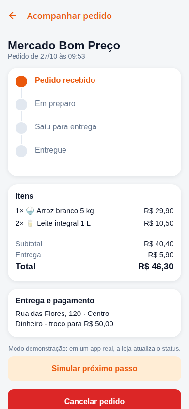

# MarketGo

O MarketGo é um aplicativo de compras com entrega. O usuário cria uma conta, escolhe uma loja, adiciona produtos ao carrinho, informa o endereço e acompanha o pedido até a entrega.

O projeto foi desenvolvido com **React Native, Expo, TypeScript e Supabase**, com suporte a Android, iOS e web. Seu objetivo é demonstrar um fluxo de compra completo, com regras de negócio, persistência local, autenticação, segurança no banco e testes automatizados.

**Os pagamentos e as entregas são simulados. Nenhum valor é cobrado.**

## Sumário

- [O que o aplicativo faz](#o-que-o-aplicativo-faz)
- [Tecnologias](#tecnologias)
- [Instalação e configuração](#instalação-e-configuração)
- [Como executar](#como-executar)
- [Como usar](#como-usar)
- [Como funciona por dentro](#como-funciona-por-dentro)
- [Como testar](#como-testar)
- [Comandos disponíveis](#comandos-disponíveis)
- [Gerar um APK](#gerar-um-apk)
- [Problemas comuns](#problemas-comuns)
- [Documentação complementar](#documentação-complementar)

## O que o aplicativo faz

| Área     | Funcionalidades                                                                                    |
| -------- | -------------------------------------------------------------------------------------------------- |
| Conta    | Cadastro com nome, e-mail e senha; login; sessão persistente; logout.                              |
| Lojas    | Busca por nome, categoria ou descrição; busca sem acentos; filtros; indicação de loja fechada.     |
| Produtos | Catálogo dividido em seções, detalhes, seletor de quantidade e adição rápida.                      |
| Carrinho | Persistência por usuário, uma loja por vez, limite de 20 unidades por produto e pedido mínimo.     |
| Checkout | Endereço de entrega, preenchimento com o último endereço, pagamento simulado e validação de troco. |
| Pedidos  | Histórico, acompanhamento, cancelamento e recompra com os preços atuais.                           |

As capturas abaixo foram geradas no navegador em uma tela de tamanho mobile. Elas usam dados de demonstração e autenticação simulada no teste automatizado.

| Lojas                                                     | Carrinho                                                                 | Checkout                                                                  | Acompanhamento                                                            |
| --------------------------------------------------------- | ------------------------------------------------------------------------ | ------------------------------------------------------------------------- | ------------------------------------------------------------------------- |
|  |  |  |  |

## Tecnologias

| Tecnologia                      | Papel no projeto                                            |
| ------------------------------- | ----------------------------------------------------------- |
| Expo SDK 58 e React Native 0.88 | Execução e desenvolvimento do aplicativo.                   |
| React 19.3 e TypeScript 6       | Componentes e tipagem do código.                            |
| Expo Router                     | Navegação baseada nos arquivos de `src/app/`.               |
| Supabase Auth                   | Cadastro, login e gerenciamento da sessão.                  |
| PostgreSQL e Supabase           | Catálogo, pedidos, políticas de acesso e funções SQL.       |
| TanStack Query                  | Cache, consultas, mutações e atualização dos pedidos.       |
| AsyncStorage                    | Armazenamento do carrinho e da sessão no aplicativo nativo. |
| React Hook Form e Zod           | Formulários e validação dos dados.                          |
| Jest e jest-expo                | Testes das regras, dos contextos e dos serviços.            |
| PGlite                          | Execução local do PostgreSQL nos testes, sem Docker.        |
| Playwright                      | Teste do fluxo de compra no navegador.                      |

## Instalação e configuração

### 1. Preparar o ambiente

Você precisa de:

- **Node.js 22 ou superior**, com npm. O projeto foi validado com Node.js 24.
- **Git** para clonar o repositório.
- Uma conta e um projeto no **Supabase** para usar o aplicativo com autenticação e dados reais do seu ambiente.
- Um navegador para executar a versão web ou um dispositivo/emulador compatível com o **Expo SDK 58**.

Confira o ambiente:

```bash
node --version
npm --version
git --version
```

Os testes locais usam um banco temporário e não exigem uma conta Supabase. Para navegar normalmente no aplicativo, configure o projeto remoto conforme os passos abaixo.

### 2. Clonar e instalar as dependências

```bash
git clone https://github.com/ApenasGui/MarketGo.git
cd MarketGo/MarketGo
npm ci
```

O repositório possui uma pasta interna chamada `MarketGo`. **Execute os comandos de npm e Expo na pasta que contém `package.json`**, e não na raiz externa do repositório.

`npm ci` instala as versões registradas em `package-lock.json`, tornando a instalação reproduzível.

### 3. Configurar o banco no Supabase

Crie um projeto no [Supabase](https://supabase.com), abra o **SQL Editor** e execute os arquivos nesta ordem:

1. [supabase/schema.sql](MarketGo/supabase/schema.sql): cria tabelas, índices, políticas de acesso e funções de pedido.
2. [supabase/seed.sql](MarketGo/supabase/seed.sql): adiciona o catálogo de demonstração, com **6 lojas e 50 produtos**.

Esses arquivos são scripts de configuração inicial. Se o banco já estiver configurado, confira o que existe antes de executá-los novamente: o esquema cria tabelas e o seed insere dados.

Em **Authentication**, confira as configurações de autenticação por e-mail. Quando a confirmação de e-mail estiver habilitada, o usuário deve confirmar a conta antes de entrar.

Para conferir o banco configurado, execute [supabase/verify.sql](MarketGo/supabase/verify.sql). O arquivo contém apenas consultas e verifica o catálogo, o RLS e as permissões das funções.

### 4. Configurar as variáveis de ambiente

Na pasta do aplicativo, copie `.env.example` para `.env`. Se o arquivo já existir, edite-o preservando a sua configuração.

No Linux/macOS ou Git Bash, para criar o arquivo quando ele ainda não existir:

```bash
test -f .env || cp .env.example .env
```

Preencha o `.env` com os valores do seu projeto:

```dotenv
EXPO_PUBLIC_SUPABASE_URL=https://SEU-PROJETO.supabase.co
EXPO_PUBLIC_SUPABASE_KEY=SUA-CHAVE-PUBLICA
```

| Variável                   | Valor esperado                                                                |
| -------------------------- | ----------------------------------------------------------------------------- |
| `EXPO_PUBLIC_SUPABASE_URL` | URL base da API do projeto, sem `/rest/v1`, `/auth/v1` ou endereço do painel. |
| `EXPO_PUBLIC_SUPABASE_KEY` | Chave pública anon ou publishable do mesmo projeto.                           |

As variáveis `EXPO_PUBLIC_` fazem parte do aplicativo distribuído. Use somente a chave pública; **não coloque a chave `service_role` nem a senha do banco no app**. A proteção dos dados é feita pelas políticas e funções do banco. O `.env` está ignorado pelo Git.

## Como executar

Todos os comandos desta seção devem ser executados na pasta do aplicativo.

### Iniciar o servidor de desenvolvimento

```bash
npm start
```

O Expo exibirá as opções de execução e um QR Code. Para usar o celular, o computador e o dispositivo devem conseguir se comunicar pela rede. Use Expo Go compatível com o SDK instalado ou um build de desenvolvimento compatível.

Em um iPhone físico com Expo Go, siga os requisitos de conta informados pelo Expo CLI; a [documentação de execução](https://docs.expo.dev/get-started/start-developing/) explica essa configuração.

### Abrir no navegador

```bash
npx expo start --web
```

A versão web usa o mesmo fluxo de telas e o mesmo projeto Supabase configurado no `.env`.

### Abrir em emulador ou simulador

```bash
npm run android
npm run ios
```

Esses comandos iniciam o Expo e solicitam a abertura na plataforma escolhida. O emulador Android precisa estar configurado; o simulador iOS depende de macOS e Xcode. Eles não geram um APK ou IPA de distribuição.

### Reiniciar após alterar o `.env`

Pare o servidor e inicie novamente limpando o cache:

```bash
npx expo start -c
```

## Como usar

1. **Crie uma conta ou entre.** Se necessário, confirme o e-mail pelo link enviado pelo Supabase.
2. **Escolha uma loja.** Use a busca ou os filtros por categoria. Lojas fechadas permitem visualizar o catálogo, mas não adicionar produtos.
3. **Monte o carrinho.** Adicione pelo botão “+” ou abra um produto para escolher a quantidade. Ao trocar de loja, o aplicativo pede confirmação para substituir os itens.
4. **Confira o pedido.** O carrinho mostra subtotal, entrega e total. Se faltar valor para o pedido mínimo, a finalização fica desabilitada.
5. **Preencha o checkout.** Informe rua, número e bairro. O complemento é opcional. Escolha Pix, cartão na entrega ou dinheiro; em dinheiro, o valor informado para troco deve cobrir o total.
6. **Confirme a compra.** O banco valida o pedido e calcula o total. Após a confirmação, o carrinho é esvaziado e o acompanhamento é aberto.
7. **Acompanhe ou simule o avanço.** Use “Simular próximo passo” para demonstrar a evolução do pedido. O cancelamento fica disponível apenas enquanto o pedido está recebido.
8. **Peça novamente.** Em um pedido entregue ou cancelado, a recompra consulta o catálogo atual. Produtos indisponíveis são deixados de fora; se já houver itens no carrinho, a substituição exige confirmação.

## Como funciona por dentro

### Navegação e organização

O Expo Router transforma os arquivos de `src/app/` nas rotas do aplicativo. Os grupos `(auth)` e `(app)` organizam as telas sem aparecer na URL. Os layouts verificam a sessão para direcionar o usuário entre autenticação e área protegida.

| Rota                   | Tela                               |
| ---------------------- | ---------------------------------- |
| `/login` e `/register` | Login e cadastro.                  |
| `/`                    | Lojas.                             |
| `/store/[id]`          | Catálogo de uma loja.              |
| `/product/[id]`        | Detalhe do produto.                |
| `/cart`                | Carrinho.                          |
| `/checkout`            | Endereço, pagamento e confirmação. |
| `/orders`              | Histórico.                         |
| `/order/[id]`          | Acompanhamento do pedido.          |
| `/profile`             | Dados da conta e logout.           |

A estrutura do código separa as responsabilidades:

```text
src/
├── app/          Telas, rotas e layouts de navegação
├── components/   Componentes reutilizáveis da interface
├── context/      Sessão do usuário e estado do carrinho
├── hooks/        Consultas, mutações e ações compartilhadas
├── services/     Comunicação com o Supabase
├── lib/          Configuração do Supabase e do TanStack Query
├── schemas/      Validação dos formulários com Zod
├── utils/        Regras de carrinho, catálogo, pedidos e dinheiro
├── types/        Tipos do domínio
├── constants/    Categorias, pagamentos e status
└── theme/        Cores, espaçamentos e estilos compartilhados
supabase/         Esquema, dados iniciais e testes do banco
__tests__/        Testes unitários e dos contextos
e2e/             Teste de interface com Playwright e PGlite
scripts/          Exportação e servidor local para os testes de interface
docs/             Capturas, roteiro de testes manuais e apresentação
```

Nas telas de dados, o caminho é **tela → hook → serviço → Supabase**. As regras que podem ser executadas sem interface ficam em funções puras em `src/utils/`.

### Sessão e carrinho persistente

O `AuthProvider` restaura a sessão ao abrir o aplicativo e acompanha os eventos de autenticação. No aplicativo nativo, a sessão usa AsyncStorage; na web, o cliente Supabase usa o armazenamento disponível no navegador. Ao sair ou trocar de usuário, o cache de consultas é limpo.

O `CartProvider` mantém um carrinho por conta, salvo com uma chave que inclui o ID do usuário. Ele carrega e valida o conteúdo armazenado antes de liberar as alterações. Um carrinho de outra conta não é exibido ao trocar de usuário. A persistência é local: ela não sincroniza o carrinho entre aparelhos.

O subtotal do carrinho é calculado em centavos para evitar erros de soma com números decimais. A taxa de entrega só entra no total quando há itens.

### Criação e segurança do pedido

O banco possui quatro tabelas principais:

| Tabela        | Responsabilidade                                                                                |
| ------------- | ----------------------------------------------------------------------------------------------- |
| `stores`      | Lojas, categorias, taxa de entrega, prazo estimado de entrega, pedido mínimo e disponibilidade. |
| `products`    | Produtos vinculados à loja e à seção do catálogo.                                               |
| `orders`      | Pedido, usuário, endereço, pagamento, valores e status.                                         |
| `order_items` | Itens do pedido, com cópias do nome e do preço no momento da compra.                            |

O checkout envia IDs e quantidades dos produtos, endereço e forma de pagamento para a função SQL `create_order`. **Os preços não são enviados pelo aplicativo.**

No servidor, essa função verifica o usuário, a loja, os produtos, as quantidades, o pedido mínimo e o troco. Em seguida, calcula os totais usando o catálogo do banco e grava pedido e itens juntos. As cópias de nome e preço preservam o histórico quando um produto muda ou sai do catálogo.

O **Row Level Security (RLS)** limita a leitura: usuários autenticados acessam o catálogo, mas só podem ler os próprios pedidos e itens. As políticas não permitem escrita direta nas tabelas de pedidos. As alterações passam pelas funções `create_order`, `advance_order` e `cancel_order`.

### Acompanhamento e recompra

O pedido percorre a sequência:

```text
Recebido → Em preparo → Saiu para entrega → Entregue
    └──→ Cancelado
```

A tela de acompanhamento consulta o pedido a cada **5 segundos enquanto ele está ativo**. Ao chegar a entregue ou cancelado, a atualização periódica para. Isso é feito com consultas pelo TanStack Query, não com Supabase Realtime.

O botão de simulação chama `advance_order`. Ele existe para demonstração; uma operação real precisaria atribuir essa ação à loja ou ao entregador. A função `cancel_order` aceita cancelamento somente no estado recebido.

“Pedir novamente” busca preços e disponibilidade atuais. O total de um pedido antigo permanece preservado; o novo carrinho usa os valores de hoje.

## Como testar

Execute os testes na pasta do aplicativo, após `npm ci`.

### Verificação principal

```bash
npm run check
```

Esse comando executa, em sequência:

1. ESLint.
2. Verificação de tipos do TypeScript.
3. Testes Jest do aplicativo.
4. Testes SQL com PGlite.

A suíte atual possui **56 testes Jest e 13 testes de banco**. Os testes de interface são executados separadamente.

### Testes do aplicativo

```bash
npm run test:app
```

Validam as regras de carrinho, busca, pedidos, checkout e dinheiro, além da autenticação, restauração da sessão, persistência do carrinho, troca de conta e chamadas RPC. As dependências externas são simuladas nos testes que precisam delas.

### Testes do banco

```bash
npm run test:db
```

O PGlite inicia um PostgreSQL temporário, carrega os arquivos `schema.sql` e `seed.sql` e verifica permissões, isolamento entre usuários, cálculo de totais, snapshots, cancelamento e avanço de status. Esses testes não precisam de Docker nem de conexão com o Supabase remoto.

Para executar os testes do app e do banco juntos:

```bash
npm test
```

### Teste completo da interface

Instale o Chromium usado pelo Playwright:

```bash
npx playwright install chromium
```

Em seguida:

```bash
npm run test:e2e
```

O comando exporta a versão web para `dist-e2e/`, abre um servidor local e executa o fluxo em uma tela de **390 × 844 pixels**. A autenticação e as respostas HTTP do Supabase são simuladas; as consultas e funções de pedido são executadas sobre o SQL real em PGlite.

O fluxo cobre cadastro, busca, filtros, loja fechada, carrinho persistente, troca de loja, validação do endereço e troco, criação do pedido, totais, status, cancelamento, recompra, isolamento entre contas e recuperação de rede.

O teste usa variáveis próprias, não altera o `.env` e não acessa o Supabase remoto. As quatro capturas de demonstração são atualizadas em `docs/screenshots/`. Em caso de falha, o Playwright salva evidências em `test-results/`.

A porta padrão é **4173**. Se estiver ocupada, escolha outra pelo `MARKETGO_E2E_PORT`. Exemplo em Linux/macOS ou Git Bash:

```bash
MARKETGO_E2E_PORT=4174 npm run test:e2e
```

### Conferência manual

Use o [roteiro de testes manuais](MarketGo/docs/TESTES-MANUAIS.md) para conferir Android/iOS e o banco remoto. Os testes locais não comprovam a configuração do seu Supabase nem substituem a verificação em um aparelho físico.

## Comandos disponíveis

| Comando                | O que faz                                                              |
| ---------------------- | ---------------------------------------------------------------------- |
| `npm start`            | Inicia o Expo.                                                         |
| `npm run android`      | Inicia o Expo solicitando abertura no Android.                         |
| `npm run ios`          | Inicia o Expo solicitando abertura no iOS.                             |
| `npx expo start --web` | Abre a versão web em desenvolvimento.                                  |
| `npm run lint`         | Executa o ESLint.                                                      |
| `npm run typecheck`    | Verifica os tipos sem gerar arquivos.                                  |
| `npm run test:app`     | Executa os testes Jest.                                                |
| `npm run test:db`      | Executa os testes SQL locais.                                          |
| `npm test`             | Executa testes do app e do banco.                                      |
| `npm run test:e2e`     | Exporta a versão web e testa o fluxo de compra.                        |
| `npm run check`        | Executa lint, tipos e testes do app e banco.                           |
| `npm run format`       | Formata `src/`, `__tests__/` e os testes SQL.                          |
| `npm run format:check` | Confere a formatação do código, testes e scripts indicados no projeto. |
| `npm run export:web`   | Gera a exportação web em `dist/`.                                      |

## Gerar um APK

A geração de um instalador Android é opcional e usa o **EAS Build**. O perfil `preview` de [eas.json](MarketGo/eas.json) está configurado para produzir um APK de distribuição interna.

Na pasta do aplicativo:

```bash
npx eas-cli@latest login
npx eas-cli@latest build:configure
```

Vincule o projeto à sua conta Expo conforme solicitado. Configure `EXPO_PUBLIC_SUPABASE_URL` e `EXPO_PUBLIC_SUPABASE_KEY` no ambiente usado pelo build no EAS e confira o perfil `preview` antes de iniciar:

```bash
npx eas-cli@latest build --platform android --profile preview
```

O build depende da conta EAS, do ambiente e das credenciais de assinatura. Uma exportação de JavaScript com Expo não equivale a um APK. Para detalhes, consulte a [documentação do EAS Build](https://docs.expo.dev/build/eas-json/).

## Problemas comuns

| Problema                                | O que conferir                                                                                                                                                  |
| --------------------------------------- | --------------------------------------------------------------------------------------------------------------------------------------------------------------- |
| `Invalid path specified in request URL` | A URL no `.env` deve ser a base do projeto Supabase, sem `/rest/v1`. Reinicie o Expo com `npx expo start -c`.                                                   |
| Variáveis do Supabase ausentes          | Confira se o `.env` está ao lado de `package.json` e se os nomes das variáveis estão corretos.                                                                  |
| Cadastro exige confirmação              | Confirme o e-mail de acordo com a configuração do Supabase Auth.                                                                                                |
| Lojas ou produtos não aparecem          | Confira o seed, o login, o projeto selecionado no `.env` e as políticas do banco.                                                                               |
| RPC não encontrada                      | Confira se o `schema.sql` foi aplicado no mesmo projeto Supabase configurado no app.                                                                            |
| QR Code não conecta                     | Confira a rede, a compatibilidade do cliente Expo e os requisitos de conta do dispositivo. Se a rede bloquear a conexão local, tente `npx expo start --tunnel`. |
| Playwright não encontra o navegador     | Execute `npx playwright install chromium` na pasta do aplicativo.                                                                                               |
| Porta 4173 ocupada                      | Encerre a execução anterior ou defina outra porta com `MARKETGO_E2E_PORT`.                                                                                      |
| Formulário ou pedido recusado           | Confira as mensagens dos campos e do banco: mínimo, disponibilidade da loja/produto e troco são validados.                                                      |

## Documentação complementar

- [Roteiro de testes manuais](MarketGo/docs/TESTES-MANUAIS.md).
- [Roteiro de apresentação de cinco minutos](MarketGo/docs/APRESENTACAO.md).
- [Esquema e regras do banco](MarketGo/supabase/schema.sql).
- [Dados de demonstração](MarketGo/supabase/seed.sql).
- [Consultas de conferência do banco](MarketGo/supabase/verify.sql).
- [Referência do Expo SDK 58](https://docs.expo.dev/versions/v58.0.0/).

## Autor e licença

Projeto de [ApenasGui](https://github.com/ApenasGui). Código disponível no [repositório MarketGo](https://github.com/ApenasGui/MarketGo).

Consulte o arquivo [LICENSE](MarketGo/LICENSE) para os termos de uso.
